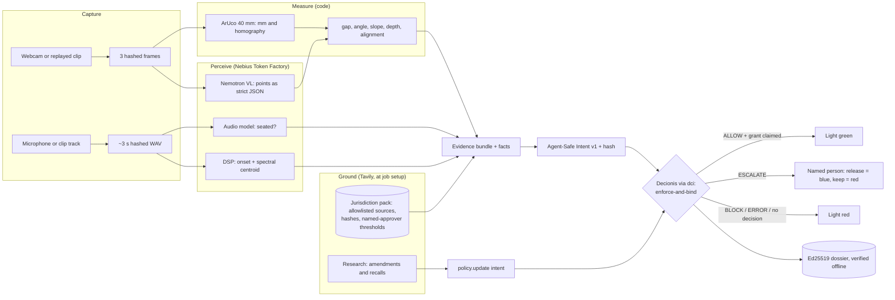

# SiteWork

**Nothing gets covered until it's proven.**

Physical AI that inspects construction work at the hold point, before it disappears, and cannot release that hold without code-grounded evidence and a signed Decionis decision record.

> Models observe → code measures → policy decides → humans sign when the AI isn't sure → everything is provable.

Status: **built; awaiting live data.** Decking, trench entry and plumbing close-in are gated by Decionis. Packs, offline proof, the amendment watch and the eval harness are in place. Model IDs and `eval/results.md` come from live runs on recorded clips (see `TODO_HUMAN.md`).

## Setup

Requires [uv](https://docs.astral.sh/uv/) and Node 18+ (for `npx @decionis/verify`).

```bash
make setup               # installs Python 3.11 and dependencies into .venv
cp -n .env.example .env  # preserves an existing .env; then fill in missing keys
make check               # verifies Token Factory, Tavily and Decionis credentials
make test
make demo                # dashboard at http://127.0.0.1:8000, stack light at /light
```

`make check` lists the Nemotron models Token Factory serves to your key, runs one Tavily search, and checks Decionis identity, routing, credential scopes for the configured gate mode, and the workspace's allowed mode. Anything it cannot verify is reported as a blocker; open items live in `TODO_HUMAN.md`.

SiteWork uses the `https://dci.decionisedge.com` gateway, explicitly selected on 29 October 2026. Its credentials are in ignored `.env`. Enforced calls and grant claims use the dedicated `DECIONIS_ENFORCE_API_KEY`; dossier reads and SHADOW calls retain `DECIONIS_API_KEY`.

`uv run --frozen python scripts/check.py --decionis-only --gate` sends one deliberately incomplete intent in the configured mode (default **ENFORCEMENT**). It expects ESCALATE or BLOCK, may record a dossier, and never claims an execution grant. Add `--gate-mode SHADOW` only to test SHADOW explicitly; a SHADOW pass does not establish enforcement readiness. See [gateway setup](docs/gateway-setup.md) for the verified enforcement result and workspace claim.

## How a decking inspection runs

1. **Capture.** `SITEWORK_SOURCE` is a webcam index, or a clip to replay; three frames are sampled.
2. **Scale.** The printed ArUco `DICT_4X4_50` marker gives millimetres and a homography onto its plane. Keep the marker flat and close to the joint: one 40 mm marker extrapolates, about 1.4 % error at 250 mm in the synthetic tests.
3. **Perceive.** Nemotron VL on Token Factory returns board-edge endpoints as strict JSON. An invalid reply is retried once.
4. **Measure.** Code computes the narrowest and widest joint gap (mm) and the largest angle between adjacent boards (°). Confidence = model confidence × marker quality × agreement across frames.
5. **Ground.** Decisions read `data/packs/<jurisdiction>.json`, never the live web. `scripts/pack.py search` proposes clauses from allowlisted pages via Tavily search and extract. `scripts/pack.py approve` adds one only with a named approver and a threshold.
6. **Decide.** An [Agent-Safe Intent v1](https://github.com/decionis/agent-safe-pipeline/blob/master/spec/intent/v1/README.md) goes to `POST /v1/authority/enforce-and-bind` through dci. The verdict (`ALLOW`, `BLOCK`, `ESCALATE`, `ERROR`) is shown verbatim. The rules the policy should apply are drafted in `policies/sitework.md`.
7. **Act.** The light turns green only for `ALLOW` with `should_execute`, and only after SiteWork claims the single-use grant (`/v1/execution/consume-token`). SiteWork never claims a grant when its own evidence carries errors.
8. **Record.** Evidence, request, response and verdict are written to `data/dossiers/<dossier_id>.json`, with the execution token redacted.

Nothing is faked: errors (no marker, model failure, missing key, no approved requirement) are sent to Decionis as facts. `DECIONIS_MODE=mock` exists for tests only and puts a red MOCK GATE banner on every page.

## Evaluation

Label every recorded clip (clean bench, Cosmos variants, outdoor) in `eval/labels.csv`, one row per clip:

| Column | Meaning |
|---|---|
| `clip` | Path from the repo root, e.g. `data/clips/rain/deck15.mp4` |
| `scene` | `decking`, `trench` or `plumbing` |
| `condition` | `clean`, `rain`, `mud`, `dusk_glare` or `outdoor` |
| `jurisdiction` | Pack the decision is grounded in (`US` or `SE`) |
| `gap_min_mm`, `gap_max_mm`, `angle_deg` | Decking truth as set on the bench (`angle_deg` is the joint misalignment for plumbing) |
| `slope_deg`, `depth_mm` | Trench truth |
| `seated` | Plumbing truth, `true` or `false` |
| `expected` | The correct verdict under the approved requirement: `ALLOW`, `BLOCK` or `ESCALATE` |
| `notes` | Free text |

Leave truth that does not apply blank. A Cosmos variant keeps its clean clip's truth, because edge control keeps the geometry.

```bash
uv run python scripts/eval.py --run-label "run 1"
```

The script runs every clip through the full pipeline and the real gate (SHADOW mode, so no grant is claimed). It then:
- verifies each dossier offline,
- appends the run to `eval/results.json`,
- re-renders `eval/results.md` from all runs.

Per condition, the report gives measurement error, correct-verdict rate, the **false-ALLOW rate** (an ALLOW where the label says otherwise), the ESCALATE rate and gate failures, plus gate p95 latency (nearest rank) and dossiers produced and verified.

Where a condition has false ALLOWs, the report suggests the lowest confidence floor that would have escalated them. Changing the floor is a policy change for a person: edit `policies/sitework.json`, run `scripts/policy.py submit --yes`, and re-run eval with a new `--run-label`. Both runs stay in the report. Mock-gate runs are refused for `eval/`.

## Plumbing: seated by ear, aligned by eye

- **When.** Pressing Inspect on the Plumbing tab records about 3 s of audio first, then takes the frames.
  - With a webcam, the default microphone records while the joint is pushed home. `SITEWORK_AUDIO_SOURCE=mic:<n>` picks a device.
  - A replayed clip uses its own audio track.
- **By ear.** Two independent judgements of the seating click:
  - The audio model on Token Factory (`NEBIUS_AUDIO_MODEL`, sent as `input_audio`) answers `seated` with a confidence, under a strict schema with one retry.
  - A deterministic DSP check looks for the strongest onset and its spectral centroid (librosa).
- **Only when both agree** is a `seat_audio` measurement recorded. A disagreement, a missing recording or a model failure becomes an error, which the policy escalates to a person.
- The DSP thresholds (`AUDIO_ONSET_RATIO`=8, `AUDIO_CENTROID_HZ`=1500) are starting values to calibrate on bench recordings of seated and unseated joints. In synthetic tests they hear a 4 kHz click and reject faint noise and an 80 Hz thud.
- **By eye.** Nemotron VL returns the pipe's and the fitting's centre lines; code measures the angle between them on the marker plane.
- **Both required.** A plumbing requirement must set a threshold for `seat_audio` (e.g. `{"min": 1}`) and for `angle_deg`, or the inspection records a grounding error and escalates. The approved requirement decides what "seated" and "aligned" mean.
- **Sources.** US: SharkBite push-to-connect guides ("the pipe pushes the green indicator ring into the viewing windows, confirming that the pipe is fully inserted"). SE: Branschregler Säker Vatteninstallation 2026 ("fixerade vinkelrätt").

## Trench, jurisdiction switch and human release

- **Trench entry** (`trench.authorize_entry`). Use a side view of the trench cross-section, with the marker standing upright in that plane and its bottom edge level. Nemotron VL returns each wall's top and toe point. Code then measures the steepest wall's slope (degrees from horizontal) and its depth. Steep walls are the sensitive case: with little horizontal run, 0.2 mm of corner error is about 0.4°.
- **Jurisdiction switch.** Choosing another jurisdiction on the dashboard re-decides the last inspection's evidence against that pack's approved requirements, without re-running perception. A new gate call produces a new dossier that names the record it was re-grounded from. US trench cites OSHA's maximum allowable slopes. Sweden's AFS 2023:13 sets no fixed slope, so an approved SE requirement carries no numeric threshold and the policy escalates to a person.
- **Named release.** An ESCALATE or REVIEW_REQUIRED shows a name field with Release hold and Keep hold. The record keeps who decided, when, any note, and Decionis's `approval_request_id`. A release turns the light **blue** ("RELEASED BY …"), never green, because green is reserved for a Decionis ALLOW with a claimed grant.

## Proof, packs and policy updates

**Prove a decision offline.** `uv run python scripts/proof.py <dossier_id> --pinned --tamper` does three things:
- Fetches the dossier's signed proof packet (`/v1/protocol/dossiers/{id}/proof-packet`) and the Decionis dossier JWKS once.
- Verifies the packet with the published `@decionis/verify@0.5.0`: offline against the saved JWKS, then against the pinned Decionis JWKS URL.
- Changes one byte inside a signed artifact and shows that verification fails.

The dashboard's Verify and Tamper buttons and the `/dossier?id=` page do the same.

**Build a jurisdiction pack.** `uv run python scripts/pack.py --jurisdiction SE build trench --qualitative`:
- Maps and crawls the pack's allowlisted seeds with Tavily; PDF seeds are extracted.
- Caches each page's text locally (`data/packs/pages/`, git-ignored) and records its URL, SHA-256 and retrieval time in `data/packs/<J>.json`.
- Proposes requirement sentences.

Lengths are converted to mm, and stated angles are kept in degrees. Slope ratios stay as written: US text is horizontal:vertical, Swedish text is vertical:horizontal. `--cached` regenerates candidates without Tavily calls. A requirement enters the pack only through `pack.py approve` with a named approver.

**Watch for amendments.** `uv run python scripts/watch.py --jurisdiction SE run`:
- Runs one Tavily Research task with a structured schema.
- Checks each finding's source against the pack allowlist.
- Proposes a `policy.update` through the Decionis gate. Only kinds, scenes, URLs, dates and title hashes are sent.

The SiteWork policy escalates every `policy.update`. A named person resolves it on the dashboard or with `scripts/watch.py resolve`.

## Bench and Cosmos preparation

Print the [40 mm ArUco marker and capture worksheet](output/pdf/sitework-bench.pdf)
at Actual Size / 100%. The [bench checklist](docs/bench-rig.md) covers board
angles, tabletop trench slopes, the unseated joint and outdoor captures.

The [Cosmos handoff](scripts/cosmos_transfer/README.md) links the resumable GPU
runner and records the AWS fallback quota requests. No SiteWork GPU run or
physical capture has been completed by this setup work.

## Environment

| Variable | Purpose |
|---|---|
| `NEBIUS_API_KEY`, `NEBIUS_BASE_URL` | Nebius Token Factory (OpenAI-compatible) |
| `NEBIUS_VLM_MODEL`, `NEBIUS_AGENT_MODEL`, `NEBIUS_AUDIO_MODEL` | Optional overrides of the model IDs recorded in `sitework/config.py` |
| `TAVILY_API_KEY` | Tavily search / extract / map / crawl / research |
| `DECIONIS_API_KEY`, `DECIONIS_ORG_ID` | Decionis read/SHADOW credential and workspace; also used for dossier retrieval |
| `DECIONIS_ENFORCE_API_KEY` | Separate `decision:enforce` key for ENFORCEMENT/PARALLEL evaluations and grant claims |
| `DECIONIS_POLICY_API_KEY` | Separate `policy:read` / `policy:write` key for authoring via `DECIONIS_API_BASE` |
| `AGENTSAFE_TENANT_KEY` | Ingress key for the selected AgentSafe tenant; distinct from the workspace API key |
| `DECIONIS_API_BASE`, `DECIONIS_GATEWAY_URL` | Decionis API and selected hosted AgentSafe gateway; no automatic switch to another tenant |
| `DECIONIS_MODE` | `live` (default). `mock` is for unit tests only |
| `DECIONIS_GATE_MODE` | `ENFORCEMENT` (default), `SHADOW` or `PARALLEL` |
| `DECIONIS_DECISION_TYPE` | Optional: sets the intent's `policy_projection.decision_type` |
| `SITEWORK_SOURCE` | Webcam index (default `0`) or a video file to replay |
| `SITEWORK_SAMPLES`, `SITEWORK_JURISDICTION`, `FIDUCIAL_MM` | Frames per inspection (3), pack to read (`US`), marker side in mm (40) |
| `SITEWORK_AUDIO_SOURCE`, `SITEWORK_AUDIO_SECONDS` | Plumbing audio: `mic`, `mic:<n>` or a file (default: the replayed clip's track, else the default mic); seconds recorded (3) |
| `AUDIO_ONSET_RATIO`, `AUDIO_CENTROID_HZ` | DSP seat-click thresholds (8, 1500 Hz); calibrate on bench recordings |

## Layout

```
sitework/   config, clients, perception, measurement, grounding, gate
scripts/    check.py, pack.py (jurisdiction packs), proof.py (dossier verify), watch.py (amendments), policy.py, cosmos/
static/     dashboard (single page, no build step)
policies/   SiteWork rules loaded into Decionis (sitework.json) and their rationale
eval/       labelled clips and results
data/       clips, jurisdiction packs, dossiers (large media git-ignored)
tests/      pytest suite
```

## Architecture



Tavily is never in the decision's hot path. Packs are built and approved beforehand, and a decision reads the pack.

## Models

Exact IDs come from Token Factory `GET /models` via `make check` and are recorded in `sitework/config.py`. Until then they are placeholders, and every inspection records "no model configured" as an error, which escalates.

| Role | Model | Runs on | Exact ID |
|---|---|---|---|
| Vision: points for boards, trench walls, pipe and fitting axes | NVIDIA Nemotron VL | Nebius Token Factory | ⟦from `make check`⟧ |
| Audio: joint seating (`input_audio`) | NVIDIA Nemotron Omni, if Token Factory accepts audio; else the fallback below | Nebius Token Factory | ⟦from `make check`⟧ |
| Weather and light variants for the stress test | NVIDIA Cosmos-Transfer2.5-2B (edge control) | ⟦Nebius AI Cloud GPU or AWS fallback⟧ | commit `2ff49d0` of `nvidia-cosmos/cosmos-transfer2.5` |

Not built, so not claimed: Cosmos Reason 2 and a Nemotron 3 Super grounding agent. Requirement thresholds are approved by a named person instead.

## Licences

- **SiteWork:** Apache-2.0 (`LICENSE`).
- **Decionis:** used only through its published HTTP API and packages. `@decionis/verify` (Apache-2.0) runs via `npx`. The Agent-Safe Intent v1 conformance vectors in `tests/vectors/` are copied unchanged from `decionis/agent-safe-pipeline` (Apache-2.0). No Decionis proprietary code is in this repository.
- **NVIDIA Cosmos:** the Cosmos code is Apache-2.0, and the model weights are under the NVIDIA Open Model License, which must be accepted on Hugging Face (see `scripts/cosmos/README.md`).
- **Audio fallback:** if Audio Flamingo 3 is self-hosted because Token Factory does not accept audio, its weights are non-commercial. That is acceptable for this hackathon, not for production.
- **Python dependencies:** OpenCV, NumPy, librosa, FastAPI, httpx, openai, tavily-python and sounddevice keep their own licences, pinned in `uv.lock`.
- **Requirement sources** (OSHA, eCFR, Arbetsmiljöverket, Svenskt Trä, Säker Vatten, Trex, TimberTech, SharkBite) are cited by URL and content hash. Their page text is cached locally (`data/packs/pages/`, git-ignored) and is not redistributed; only short approved excerpts appear in the packs.
