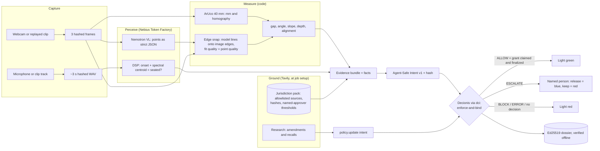

# SiteWork

**Nothing gets covered until it's proven.**

Physical AI that inspects construction work at the hold point, before it disappears, and cannot release that hold without code-grounded evidence and a signed Decionis decision record.

> Models observe → code measures → policy decides → humans sign when the AI isn't sure → everything is provable.

**Status (30 October 2026): built and validated live; calibrated bench accuracy not yet measured.**

- **Live releases:** decking and trench release through the real Decionis gate. Synthetic in-limit clips were allowed, claimed and finalized, and turned green; a steep trench was blocked; Sweden escalated.
- **Live human paths:** a named human release (blue) and a real webcam were exercised live ([readiness notes](docs/live-demo-readiness.md)).
- **Refusal evaluation:** outdoor clips and their Cosmos weather variants were refused 18 out of 18 times, with no false ALLOW ([results](eval/results.md)).
- **Still needed:** measured bench clips, for accuracy figures ([TODO_HUMAN.md](TODO_HUMAN.md)).

## Setup

Requires [uv](https://docs.astral.sh/uv/), Node 18+ (for `npx @decionis/verify`) and `ffmpeg` (reads a replayed clip's audio; without it the plumbing seat check escalates).

```bash
make setup               # Python 3.11 and dependencies into .venv
cp -n .env.example .env  # keeps an existing .env; fill in the missing keys
make check               # verifies Token Factory, Tavily and Decionis
make test && make test-ui
make demo                # dashboard at http://127.0.0.1:8000, stack light at /light
```

`make check` lists the Nemotron models Token Factory serves to your key, runs one Tavily search, and checks Decionis identity, routing, key scopes for the configured gate mode, and the workspace's allowed mode. Anything it cannot verify is reported as a blocker.

**Phone as the stack light:** run `make demo HOST=0.0.0.0` and open `http://<this machine's IP>:8000/light` on the phone. Only on a network you trust: the API has no login, so anyone who can reach it can record a human release.

**Running it elsewhere:** `make demo` runs locally. A judge needs their own credentials and a camera or clips; a public URL needs a separate app host that keeps the keys server-side. The Cosmos GPU was only for offline video generation and is not needed to run SiteWork.

## Dashboard

Pick the hold point, site condition and jurisdiction, then **Run inspection**. **Capture setup** opens a camera or a video path on the app's host; it doesn't upload from the browser. The live feed outlines the calibration marker; the inspected frame carries the measurements.

- **Hold status vs. verdict:** the hold status is shown separately from the Decionis verdict.
  - An ALLOW whose release wasn't completed stays closed.
  - A human release shows blue.
  - A disconnected page stops showing green.
  - Changing the source or setup marks the last result as previous, and the stack light goes dark.
- **Dossier page:** separates signature integrity from verified issuer identity.
- **No build step:** the frontend is plain ES modules.

## Decionis gateway

SiteWork uses the `https://dci.decionisedge.com` gateway, selected on 29 October 2026, with credentials in the ignored `.env`. Enforced calls and grant claims use `DECIONIS_ENFORCE_API_KEY`; dossier reads and SHADOW calls use `DECIONIS_API_KEY`.

`uv run --frozen python scripts/check.py --decionis-only --gate` sends one deliberately incomplete intent in the configured mode (default ENFORCEMENT). It expects ESCALATE or BLOCK and never claims a grant. A SHADOW pass (`--gate-mode SHADOW`) doesn't show enforcement readiness. See [gateway setup](docs/gateway-setup.md).

## How a decking inspection runs

1. **Capture.** `SITEWORK_SOURCE` is a webcam index, or a clip to replay; three frames are sampled.
2. **Scale.** The printed ArUco `DICT_4X4_50` marker gives millimetres and a homography onto its plane. Keep the marker flat and close to the joint: one 40 mm marker extrapolates, about 1.4 % error at 250 mm in the synthetic tests.
3. **Perceive.** Nemotron VL on Token Factory returns roughly where each board's four corners are, as strict JSON on its 0–1000 grid; code converts that to pixels and takes the two long sides as the board's edges. (Asked for edges directly, the model returned box diagonals.) An invalid reply is retried once.
4. **Snap.** Code moves each proposed edge onto the strongest straight image edge within reach (4 % of the longer image side), using gradient profiles and a robust line fit, and finds where that edge starts and stops, so lengths come from the image rather than the model. Point quality = how much of the line the image supports × how straight the edge is × how clearly it beats rival parallel edges such as wood grain. Each board is tried both darker and lighter than its surroundings, and a near tie lowers the quality. A line with no clear edge under it, or two overlapping boards, is an error, so the inspection escalates instead of measuring a guess. `SNAP_EDGES=false` uses the model's lines as given.
5. **Measure.** Code computes the narrowest and widest joint gap (mm) and the largest angle between adjacent boards (°) on the snapped lines. Confidence = point quality × marker quality × agreement across frames.
6. **Ground.** Decisions read `data/packs/<jurisdiction>.json`, never the live web. `scripts/pack.py search` proposes clauses from allowlisted pages via Tavily search and extract. `scripts/pack.py approve` adds one only with a named approver and a threshold.
7. **Decide.** An [Agent-Safe Intent v1](https://github.com/decionis/agent-safe-pipeline/blob/master/spec/intent/v1/README.md) goes to `POST /v1/authority/enforce-and-bind` through dci. The verdict (`ALLOW`, `BLOCK`, `ESCALATE`, `ERROR`) is shown verbatim. The rules the policy should apply are drafted in `policies/sitework.md`.
8. **Act.** Each intent commits, before dispatch, to its expected effect: this inspection's light turning green (`expected_effect_digest`).
   - **Green requires all of:** `ALLOW` with `should_execute`, then SiteWork claims the single-use grant (`/v1/execution/claim-token`) and reports the release `COMMITTED` (`/v1/execution/finalize-token`) inside the claim's 30-second lease. A claim left unfinalized goes `INDETERMINATE`, and Decionis refuses later claims on that target until it is reconciled.
   - **SiteWork never claims** when:
     - its own evidence has errors
     - it lacks a citation or a checked measurement
     - a measurement is outside its limit
     - the verdict is a re-decision
     - the mode isn't ENFORCEMENT
     - the action releases nothing physical (e.g. `policy.update`)
   - **Effect confirmation:** Decionis reports the effect as unconfirmed, because nothing observes the phone screen.
9. **Record.** Evidence, request, response and verdict are written to `data/dossiers/<dossier_id>.json`, with the execution token redacted.

Nothing is faked: errors (no marker, model failure, missing key, no approved requirement) are sent to Decionis as facts. `DECIONIS_MODE=mock` exists for tests only and puts a red MOCK GATE banner on every page.

## Evaluation

Label every recorded clip (clean bench, Cosmos variants, outdoor) in `eval/labels.csv`, one row per `(clip, jurisdiction)` pair. The [capture plan](docs/bench-rig.md) separates fixture targets, independent measurements and calibration takes. Reusing a file under US and SE is a paired evaluation; the report counts rows, not independent videos.

| Column | Meaning |
|---|---|
| `clip` | Path from the repo root, e.g. `data/clips/rain/deck15.mp4` |
| `scene` | `decking`, `trench` or `plumbing` |
| `condition` | `clean`, `rain`, `mud`, `dusk_glare` or `outdoor` |
| `jurisdiction` | Pack the decision is grounded in (`US` or `SE`) |
| `gap_min_mm`, `gap_max_mm`, `angle_deg` | Decking truth as set on the bench (`angle_deg` is the joint misalignment for plumbing) |
| `slope_deg`, `depth_mm` | Trench truth |
| `seated` | Plumbing truth, `true` or `false` |
| `expected` | The correct verdict under the approved requirement: `ALLOW`, `BLOCK` or `ESCALATE` |
| `notes` | Free text |

Leave inapplicable or unknown truth blank. Review each Cosmos variant before inheriting its clean clip's truth: edge control does not guarantee unchanged geometry, visibility or seating evidence.

The [approved requirements](docs/requirements.md) name Festus B. Jejelowo. US decking uses the TimberTech Advanced PVC/Cortex spacing profile (3.175–6.35 mm); US trench uses OSHA Option 1's stated 34° limit. SE decking, SE trench and both plumbing profiles are qualitative and currently escalate. The current labels are input-refusal cases only:
- three outdoor pipe/drainage clips;
- the Cosmos rain, mud and dusk-glare variants of two of them.

Each is paired across US and SE, giving 18 rows from nine unique videos, with no dimensional or seating truth. Read [the evaluation scope](eval/README.md) before interpreting any numbers.

The latest [run](eval/results.md) escalated all 18 cases, with no false ALLOW in any condition and 18/18 dossiers verified offline. Gate p95 was 735.5 ms. No vision inference ran, because no frame shows a calibration marker. The run shows that SiteWork refuses what it cannot measure; it does not measure accuracy.

```bash
uv run python scripts/eval.py --run-label "run 1"
```

The script runs every clip through the full pipeline and the real gate (SHADOW mode, so no grant is claimed). It then:
- verifies each dossier offline,
- appends the run to `eval/results.json`,
- re-renders `eval/results.md` from all runs.

Per condition, the report gives measurement error, correct-verdict rate, the **false-ALLOW rate** (an ALLOW where the label says otherwise), the ESCALATE rate and gate failures, plus gate p95 latency (nearest rank) and dossiers produced and verified.

Where a condition has false ALLOWs, the report suggests the lowest confidence floor that would have escalated them. Changing the floor is a policy change for a person: edit `policies/sitework.json`, run `scripts/policy.py submit --yes`, and re-run eval with a new `--run-label`. Both runs stay in the report. Mock-gate runs are refused for `eval/`.

## Plumbing: seated by ear, aligned by eye

- **When.** Pressing Inspect on the Plumbing tab records about 3 s of audio first, then takes the frames.
  - With a webcam, the default microphone records while the joint is pushed home. `SITEWORK_AUDIO_SOURCE=mic:<n>` picks a device.
  - A replayed clip uses its own audio track.
- **By ear.** A deterministic DSP check (librosa) measures the strongest onset and its spectral centroid.
  - A seat click is a sharp, high-frequency transient. The reading is the `seat_audio` measurement.
  - Its confidence is how far the deciding feature is past its threshold: 0 at the threshold, 1 at 50% past it. A borderline reading therefore falls under the policy's confidence floor and escalates.
  - Token Factory rejects audio input (`input_audio`, HTTP 422) for every model it lists, so no audio model is used by default.
  - `AUDIO_MODE=model+dsp` switches to an audio model that must agree with the DSP, for a self-hosted model. A disagreement, a missing recording or a model failure is then an error, which escalates.
- The DSP thresholds (`AUDIO_ONSET_RATIO`=8, `AUDIO_CENTROID_HZ`=1500) are starting values to calibrate on bench recordings of seated and unseated joints. In synthetic tests they hear a 4 kHz click and reject faint noise and an 80 Hz thud.
- **By eye.** Nemotron VL returns the pipe's and the fitting's centre lines. Code snaps each to the same-side border of that body and measures the angle between them on the marker plane.
- **Both required.** A plumbing requirement must bound `seat_audio` and `angle_deg`, or the inspection records a grounding error and escalates. Both current approvals remain qualitative: a source's insertion requirement does not establish an acoustic acceptance test or a numeric alignment tolerance.
- **Sources.** US: SharkBite requires insertion to the tube stop, verified by the product-specific insertion mark. SE: Säker Vatteninstallation 2026:1 §7.3 requires installation according to the supplier instructions. Its perpendicular-penetration rule concerns a different geometry from pipe-to-fitting alignment. See [the approval review](docs/requirements.md).

## Trench, jurisdiction switch and human release

- **Trench entry** (`trench.authorize_entry`). Use a side view of the trench cross-section, with the marker standing upright in that plane and its bottom edge level. Nemotron VL returns each wall's top and toe point. Code snaps the line between them to the wall's image edge, then measures the steepest wall's slope (degrees from horizontal) and its depth. Depth comes from where that edge stops at the ground surface and at the floor, found in the image. A wall end that runs out of the picture is an error, and so the inspection escalates; an object covering a corner looks like the wall's end, so keep both corners clear. Steep walls are the sensitive case: with little horizontal run, 0.2 mm of corner error is about 0.4°.
- **Jurisdiction switch.** Choosing another jurisdiction re-decides the last inspection's evidence against that pack, without re-running perception. The new gate call gets its own dossier, which names the record it came from. US trench cites OSHA's maximum allowable slopes. The approved Swedish requirement, Arbetsmiljöverket's excavation guidance, sets no fixed slope, so the policy escalates to a person. A re-decision never releases a hold, even on ALLOW: that takes a fresh inspection.
- **Named release.** An ESCALATE or REVIEW_REQUIRED shows a name field with Release hold and Keep hold. The record keeps who decided, when, any note, and Decionis's `approval_request_id`. A release turns the light **blue** ("RELEASED BY …"), never green, because green is reserved for a Decionis ALLOW whose grant was claimed and finalized. The resolution is stored alongside the signed dossier, not inside it.

## Proof, packs and policy updates

**Prove a decision offline.** `uv run python scripts/proof.py <dossier_id> --pinned --tamper` does three things:
- Fetches the dossier's signed proof packet (`/v1/protocol/dossiers/{id}/proof-packet`) and the Decionis dossier JWKS once.
- Verifies the packet with the published `@decionis/verify@0.5.0`: offline against the saved JWKS, then against the pinned Decionis JWKS URL.
- Changes one byte inside a signed artifact and shows that verification fails.

The dashboard's Verify and Tamper buttons and the `/dossier?id=` page do the same.

**Build a jurisdiction pack.** `uv run python scripts/pack.py --jurisdiction SE build trench --qualitative`:
- Maps and crawls the pack's allowlisted seeds with Tavily; PDF seeds are extracted.
- Caches each page's text locally (`data/packs/pages/`, git-ignored) and records its URL, SHA-256 and retrieval time in `data/packs/<J>.json`.
- Proposes requirement sentences.

Lengths are converted to mm, and stated angles are kept in degrees. Slope ratios stay as written: US text is horizontal:vertical, Swedish text is vertical:horizontal. `--cached` regenerates candidates without Tavily calls. A requirement enters the pack only through `pack.py approve` with a named approver.

**Watch for amendments.** `uv run python scripts/watch.py --jurisdiction SE run`:
- Runs one Tavily Research task with a structured schema.
- Checks each finding's source against the pack allowlist.
- Proposes a `policy.update` through the Decionis gate. Only kinds, scenes, URLs, dates and title hashes are sent.

The SiteWork policy escalates every `policy.update`; a named person resolves it on the dashboard or with `scripts/watch.py resolve`. A proposal that Decionis blocked, or never decided, can only be rejected.

## Bench and Cosmos preparation

Print the [40 mm ArUco marker and capture worksheet](output/pdf/sitework-bench.pdf)
at Actual Size / 100%. The [bench checklist](docs/bench-rig.md) covers board
angles, tabletop trench slopes, the unseated joint and outdoor captures.

**Cosmos:** nine rain, mud and dusk-glare variants of three outdoor segments were generated on a US Nebius RTX PRO 6000. All 837 frames decode, and the temporary VM and disk were deleted afterwards.
- [RUN_INFO.md](data/clips/RUN_INFO.md) records the settings and timings, and the [handoff](scripts/cosmos_transfer/README.md) links the resumable runner.
- The sources have no independent measurements, so the variants are stress inputs: they test refusal, not accuracy.

## Environment

| Variable | Purpose |
|---|---|
| `NEBIUS_API_KEY`, `NEBIUS_BASE_URL` | Nebius Token Factory (OpenAI-compatible) |
| `NEBIUS_VLM_MODEL`, `NEBIUS_AGENT_MODEL`, `NEBIUS_AUDIO_MODEL` | Optional overrides of the model IDs recorded in `sitework/config.py` |
| `NEBIUS_VLM_THINKING`, `NEBIUS_VLM_CONSTRAINED` | Vision request options (default off / on): without constrained decoding Nemotron VL answers in prose |
| `TAVILY_API_KEY` | Tavily search / extract / map / crawl / research |
| `DECIONIS_API_KEY`, `DECIONIS_ORG_ID` | Decionis read/SHADOW credential and workspace; also used for dossier retrieval |
| `DECIONIS_ENFORCE_API_KEY` | Separate `decision:enforce` key for ENFORCEMENT/PARALLEL evaluations and grant claims |
| `DECIONIS_POLICY_API_KEY` | Separate `policy:read` / `policy:write` key for authoring via `DECIONIS_API_BASE` |
| `AGENTSAFE_TENANT_KEY` | Ingress key for the selected AgentSafe tenant; distinct from the workspace API key |
| `DECIONIS_API_BASE`, `DECIONIS_GATEWAY_URL` | Decionis API and selected hosted AgentSafe gateway; no automatic switch to another tenant |
| `DECIONIS_MODE` | `live` (default). `mock` is for unit tests only |
| `DECIONIS_GATE_MODE` | `ENFORCEMENT` (default), `SHADOW` or `PARALLEL` |
| `DECIONIS_DECISION_TYPE` | Optional: sets the intent's `policy_projection.decision_type` |
| `SITEWORK_SOURCE` | Webcam index (default `0`) or a video file to replay |
| `SITEWORK_SAMPLES`, `SITEWORK_JURISDICTION`, `FIDUCIAL_MM`, `FIDUCIAL_ID` | Frames per inspection (3), pack to read (`US`), marker side in mm (40), the printed marker's ID (0); any other `DICT_4X4_50` ID in the frame is ignored |
| `SITEWORK_AUDIO_SOURCE`, `SITEWORK_AUDIO_SECONDS` | Plumbing audio: `mic`, `mic:<n>` or a file (default: the replayed clip's track, else the default mic); seconds recorded (3) |
| `AUDIO_MODE` | `dsp` (default): the DSP decides. `model+dsp`: an audio model must agree with it |
| `AUDIO_ONSET_RATIO`, `AUDIO_CENTROID_HZ` | DSP seat-click thresholds (8, 1500 Hz); calibrate on bench recordings |
| `SNAP_EDGES`, `SNAP_REACH_FRAC` | Snap model lines to image edges (on); search reach either side as a share of the longer image side (0.04) |

## Layout

```
sitework/   config, clients, perception, measurement, grounding, gate
scripts/    check.py, pack.py (jurisdiction packs), proof.py (dossier verify), watch.py (amendments), policy.py, cosmos/
static/     dashboard, stack light and dossier pages (plain ES modules, no build step)
policies/   SiteWork rules loaded into Decionis (sitework.json) and their rationale
eval/       labels, results and evaluation scope
data/       clips, jurisdiction packs, dossiers (large media git-ignored)
tests/      pytest suite and node UI tests (ui.test.mjs)
```

## Architecture



Tavily is never in the decision's hot path. Packs are built and approved beforehand, and a decision reads the pack.

## Models

Exact IDs come from Token Factory `GET /models` via `make check` and are recorded in `sitework/config.py`. On 29 October 2026 the `us-central1` endpoint listed 18 models and no vision model; the global endpoint listed 30, including Nemotron VL, so SiteWork uses the global endpoint. A missing or failing model is recorded as an error, which escalates.

Nemotron VL answers on a 0–1000 grid whatever image size the prompt states, so SiteWork asks for that grid and converts it. Its points are a starting place, not a measurement: code snaps them to image edges (step 4 above).

| Role | Model | Runs on | Exact ID |
|---|---|---|---|
| Vision: points for boards, trench walls, pipe and fitting axes | NVIDIA Nemotron 3.5 Super VL (thinking off, schema-constrained JSON) | Nebius Token Factory, global endpoint | `nvidia/Nemotron-3.5-Super-VL` |
| Audio: joint seating | No model: a deterministic DSP check (librosa onset strength and spectral centroid). Token Factory rejects `input_audio` for every model it lists (HTTP 422, 29 Oct 2026) | SiteWork process | — |
| Weather and light variants for the stress test | NVIDIA Cosmos-Transfer2.5-2B (distilled edge control) | Nebius AI Cloud, US `us-central1`, offline generation | commit `2ff49d0` of `nvidia-cosmos/cosmos-transfer2.5` |

Not built, so not claimed: Cosmos Reason 2 and a Nemotron 3 Super grounding agent. Requirement thresholds are approved by a named person instead.

## Licences

- **SiteWork:** Apache-2.0 (`LICENSE`).
- **Decionis:** used only through its published HTTP API and packages. `@decionis/verify` (Apache-2.0) runs via `npx`. The Agent-Safe Intent v1 conformance vectors in `tests/vectors/` are copied unchanged from `decionis/agent-safe-pipeline` (Apache-2.0). No Decionis proprietary code is in this repository.
- **NVIDIA Cosmos:** the Cosmos code is Apache-2.0, and the model weights are under the NVIDIA Open Model License, which must be accepted on Hugging Face (see `scripts/cosmos/README.md`).
- **Audio:** no audio model is used; the seat check is the DSP (librosa). If Audio Flamingo 3 is ever self-hosted for `AUDIO_MODE=model+dsp`, its weights are non-commercial: acceptable for a hackathon, not for production.
- **Python dependencies:** OpenCV, NumPy, librosa, FastAPI, httpx, openai, tavily-python and sounddevice keep their own licences, pinned in `uv.lock`.
- **Requirement sources** (OSHA, eCFR, Arbetsmiljöverket, Svenskt Trä, Säker Vatten, Trex, TimberTech, SharkBite) are cited by URL and content hash. Their page text is cached locally (`data/packs/pages/`, git-ignored) and is not redistributed; only short approved excerpts appear in the packs.
